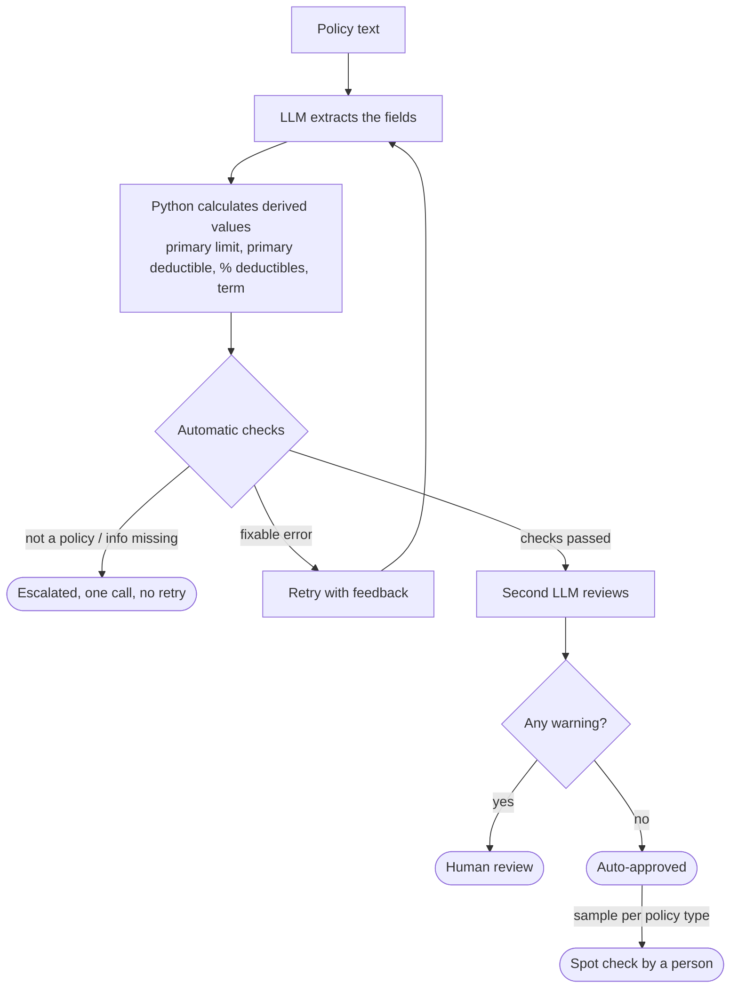

# Insurance Policy Extractor
This pipeline reads renewal declarations pages for auto, home, umbrella and specialty insurance policies. The input is text extracted from PDFs (directly, or with OCR for scanned pages), in many different carrier layouts.

An LLM returns a structured output — JSON that follows a fixed schema, with the key fields: carrier, policyholder, policy period, premium, limits,
deductibles, endorsements and exclusions.
For each document, the pipeline decides whether the record can be approved automatically, needs review by a person, or must be escalated.

## What happens to each document

| Outcome | When |
|---|---|
| **Auto-approved** | No warning signal of any kind. A sample per policy type goes to a **spot check**. |
| **Human review** | At least one signal fired; each is listed by name, with the reviewer's own words when it disagreed. |
| **Escalated** | No record a person could approve: not a policy, required information absent from the document, or a processing failure (refusal, truncation, API error). Each has its own category. |

<br>

### Examples of issues:

Issue | Outcome |
---|---|
Premium lines add up to 2,350.00, the stated premium is 2,400.00 | Human review as a **document discrepancy**: the retry returned the same numbers and the record keeps them as printed |
Expiration date equals the effective date | Human review as a document discrepancy |
Endorsements referenced to a schedule that is not included | Escalated after one call, nothing invented |
Premium "shown on the billing statement under separate cover" | Escalated after one call |
A claim letter and a mid-term change notice | Escalated as not a policy, never reviewed |
Fine-art floater and boat policy | Human review as `other`, not forced into auto or home |
Exclusions list marked partial | Human review |
Percentage deductibles, with and without the computed amount | Computed in Python and checked against the stated amount |

## How it works



## Design decisions

- **Classify a failure before retrying it.** <br>
  Asking again for a premium the document does not
  state only invites the model to invent one, so absent information costs one call and goes to a
  person.
- **The document can be wrong, and the pipeline says so.** <br>
  Inconsistent figures are kept as
  printed and reported as a discrepancy, never adjusted until a check passes.
- **Every value must be grounded.** <br>Its quote must occur in the document, and a number must be
  readable from its own quote ("$1M", "in thousands" and dates in words included). This is also
  what stops a retry from quietly changing a stated number.
- **Confidence is one signal, never the only one.** <br>A document also goes to human review when the second LLM disagrees with a value, a check still fails after the retry, the policy is a specialty product, or the exclusions list is incomplete.
- **The reviewer gets the definitions, not the opinion.** <br>It sees the document, the same field
  definitions and the values, but no confidences, quotes or retry history.
- **Measured, not assumed.**<br> The pipeline checks whether the LLM's confidence matches its actual accuracy, separately for each policy type and field. A problem limited to one of them, e.g. deductibles on home policies, would be hidden in an overall average.
- **Every document ends in exactly one output file**, <br>and an error on one document does not stop
  the run.

## Run it

Requires Python 3.14 and [uv](https://docs.astral.sh/uv/).

```bash
uv sync

# Offline, no API key: replay the recorded responses for the whole dataset
uv run policy-extractor run data/policies/ --out runs/latest --mode replay
uv run policy-extractor eval runs/latest --gold data/gold

# Tests, types, lint (all offline; 113 tests)
uv run pytest
uv run mypy src/
uv run ruff check . && uv run ruff format --check .
```

Live runs need `ANTHROPIC_API_KEY` (and `ANTHROPIC_BASE_URL` when going through a proxy) in
`.env`; see `.env.example`.

```bash
uv run policy-extractor extract data/policies/POL-2025-010.txt              # one document
uv run policy-extractor run data/policies/ --out runs/latest                # all documents
uv run policy-extractor run data/policies/ --out runs/latest --mode record  # and save responses
uv run policy-extractor batch data/policies/ --out runs/batch               # Message Batches, half price
uv run pytest -m live                                                       # smoke test both models
```

`--mode record` saves every model response under `fixtures/recorded/`, keyed by a hash of the
request, so a changed prompt invalidates its recording on purpose; `--mode replay` re-runs from
the recordings and fails on a missing one instead of calling the network.

## Known limitations

- **Tuned on its own test set.** The 22 documents were also used to tune the field definitions,
  so the accuracy above is optimistic. A held-out set is the next step.
- **Small synthetic set, text not PDFs.** 22 fictional documents; OCR noise is only simulated
  (document 011).
- **The confidence threshold is a starting point.** Five correct documents were held back by
  confidences between 0.85 and 0.89; whether to lower 0.90 is a cost-of-error decision the
  calibration table should inform.


Python 3.14, uv, the official `anthropic` SDK, Pydantic, Typer, pytest, mypy (strict), ruff.