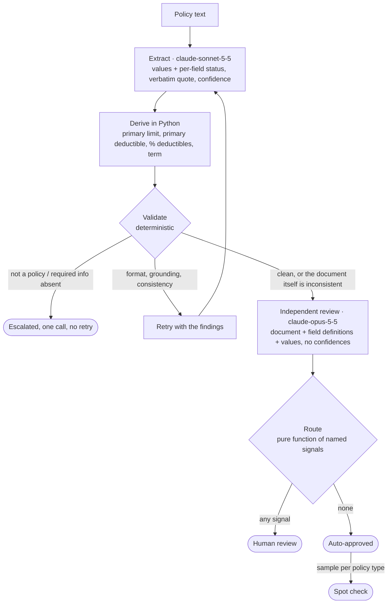

# Insurance Policy Extractor

**When can you act on what an LLM read from a document without a person checking it, and how do
you know?**

This pipeline turns insurance policy renewal declarations (plain text from PDFs and OCR, many
carrier layouts) into structured records with Claude: carrier, policyholder, term, premium,
limits, deductibles, endorsements, exclusions. Reading the page is the easy part. The project is
about trust: for every document it decides whether the record can be approved automatically,
needs a person, or must be escalated, and then measures whether those decisions were right.

## Results

One recorded live run over 22 synthetic documents (auto, home, umbrella and specialty policies,
13 carrier layouts, deliberate traps), scored against hand-written gold labels.
`claude-sonnet-5-5` extracts at effort `medium`; `claude-opus-5-5` reviews at effort `high`.
Full report: [runs/examples/eval_report.md](runs/examples/eval_report.md).

| Measure | Result |
|---|---|
| Auto-approved records with a wrong field | **0** |
| Field accuracy (17 fields x 20 policies) | 99.7% |
| Routing decision as labelled | 17 / 22 |
| Escalations with the right category | 5 / 5 |
| Reviewer: extractor errors caught / correct fields wrongly disputed | 1 / 0 |
| Cost at list prices | $0.81 in total, $0.037 per document (45 calls; prompt cache read on every call after the first) |

The five routing mismatches are all the safe kind: documents that could have been approved but
went to a person only because the extractor reported a confidence of 0.85 or 0.88 on a field
it had in fact read correctly. None went the other way.

### Why it was rebuilt, and what changed

An earlier prototype extracted the same documents and failed in ways that look fine in a demo:

- **0 of 9 policies were auto-approved.** The reviewer kept disputing "the" deductible or "the"
  limit, because a policy has several, and it never saw how the field was defined.
- **A retry hid a real error in a document.** A policy whose premium lines do not add up passed
  validation after the model "corrected" a number on the second attempt.
- **One API error stopped the whole run**, and escalated documents appeared in no output file.

This version extracts every limit and deductible as a list, computes the primary ones in Python
with explicit rules, gives the extractor and the reviewer the same field definitions, and never
lets a retry change a number the document states: a retry answers with a patch of the fields a
finding named, and any other change against the first reading (a dropped premium line, say) is
reported as `changed_on_retry` and sent to a person. The field definitions were then tuned against
the evaluation:

| Run | Routing as labelled | Auto-approved | Field accuracy | Reviewer false disputes |
|---|---|---|---|---|
| First run | 14 / 22 | 4 | 98.8% | 1 |
| After tuning field definitions | 17 / 22 | 7 | 99.7% | 0 |

The first run showed the extractor under-confident on `exclusions_complete` (the only reason for
review on most correct documents) and missing that a heading such as "DEDUCTIBLES (Primary)"
labels the deductibles under it. Both were fixed in the definitions, not in the routing threshold.

## What happens to each document

| Outcome | When |
|---|---|
| **Auto-approved** | No warning signal of any kind. A sample per policy type goes to a **spot check**. |
| **Human review** | At least one signal fired; each is listed by name, with the reviewer's own words when it disagreed. |
| **Escalated** | No record a person could approve: not a policy, required information absent from the document, or a processing failure (refusal, truncation, API error). Each has its own category. |

The documents built as traps ended where they should:

| Document | Trap | Outcome |
|---|---|---|
| 010 | Premium lines add up to 2,350.00, the stated premium is 2,400.00 | Human review as a **document discrepancy**: the retry returned the same numbers and the record keeps them as printed |
| 019 | Expiration date equals the effective date | Human review as a document discrepancy |
| 009, 020 | Endorsements referenced to a schedule that is not included | Escalated after one call, nothing invented |
| 015 | Premium "shown on the billing statement under separate cover" | Escalated after one call |
| 016, 017 | A claim letter and a mid-term change notice | Escalated as not a policy, never reviewed |
| 008, 014 | Fine-art floater and boat policy | Human review as `other`, not forced into auto or home |
| 003 | Exclusions list marked partial | Human review |
| 004, 005, 012 | Percentage deductibles, with and without the computed amount | Computed in Python and checked against the stated amount |

All traps are listed in [data/README.md](data/README.md).

## How it works



| Module | Responsibility |
|---|---|
| `fields.py` | The field definitions, written once and used by both the extractor and the reviewer prompts |
| `models.py`, `extract.py`, `prompts.py` | One structured-output call returning `PolicyExtraction`; an absent value carries a status (`not_stated`, `referenced_not_attached`, `illegible`) |
| `derive.py` | Values Python can compute are never asked of the model; an ambiguous rule returns `None`, not a guess |
| `validate.py` | Findings in categories `not_a_policy`, `missing_source`, `format`, `consistency`, `grounding` |
| `retry.py` | The category decides what happens; a consistency error that survives a retry unchanged is the document's |
| `review.py` | A different, stronger model; per field `agree`, `disagree` or `not_verifiable` with a reason |
| `route.py`, `sampling.py` | Routing and stratified spot checks, both pure and deterministic |
| `evaluate.py` | Per-field and derived-field accuracy, routing confusion, calibration by policy type x field, reviewer value, cost |
| `llm.py`, `batch.py` | SDK adapter with record/replay, and the Message Batches path |
| `runlog.py` | `records`, `decisions`, `escalations` and `events` as JSONL, plus a summary |

## Design decisions

- **Classify a failure before retrying it.** Asking again for a premium the document does not
  state only invites the model to invent one, so absent information costs one call and goes to a
  person.
- **The document can be wrong, and the pipeline says so.** Inconsistent figures are kept as
  printed and reported as a discrepancy, never adjusted until a check passes.
- **Every value must be grounded.** Its quote must occur in the document, and a number must be
  readable from its own quote ("$1M", "in thousands" and dates in words included). This is also
  what stops a retry from quietly changing a stated number.
- **Confidence is one signal, never the only one.** The reviewer, unresolved findings, a specialty
  product and a partial exclusions list can each send a record to a person.
- **The reviewer gets the definitions, not the opinion.** It sees the document, the same field
  definitions and the values, but no confidences, quotes or retry history.
- **Measured, not assumed.** Calibration is reported per policy type x field, because one
  overconfident slice disappears inside a good average.
- **Every document ends in exactly one output file**, and an error on one document does not stop
  the run.

## Run it

Requires Python 3.14 and [uv](https://docs.astral.sh/uv/).

```bash
uv sync

# Offline, no API key: replay the recorded responses for the whole dataset
uv run policy-extractor run data/policies/ --out runs/latest --mode replay
uv run policy-extractor eval runs/latest --gold data/gold

# Tests, types, lint (all offline; 113 tests)
uv run pytest
uv run mypy src/
uv run ruff check . && uv run ruff format --check .
```

Live runs need `ANTHROPIC_API_KEY` (and `ANTHROPIC_BASE_URL` when going through a proxy) in
`.env`; see `.env.example`.

```bash
uv run policy-extractor extract data/policies/POL-2025-010.txt              # one document
uv run policy-extractor run data/policies/ --out runs/latest                # all documents
uv run policy-extractor run data/policies/ --out runs/latest --mode record  # and save responses
uv run policy-extractor batch data/policies/ --out runs/batch               # Message Batches, half price
uv run pytest -m live                                                       # smoke test both models
```

`--mode record` saves every model response under `fixtures/recorded/`, keyed by a hash of the
request, so a changed prompt invalidates its recording on purpose; `--mode replay` re-runs from
the recordings and fails on a missing one instead of calling the network.

## Known limitations

- **Tuned on its own test set.** The 22 documents were also used to tune the field definitions,
  so the accuracy above is optimistic. A held-out set is the next step.
- **Small synthetic set, text not PDFs.** 22 fictional documents; OCR noise is only simulated
  (document 011).
- **The confidence threshold is a starting point.** Five correct documents were held back by
  confidences between 0.85 and 0.89; whether to lower 0.90 is a cost-of-error decision the
  calibration table should inform.
- **The Batches path needs a direct Anthropic key.** The Vocareum proxy used for the live runs
  does not offer the Batches API; the path is covered by offline tests.
- **Schema size.** Structured outputs rejected a schema that wrapped every field in its own object
  with nullable members ("compiled grammar is too large"), so values and per-field evidence come
  back as a flat record plus an evidence list.

## Repository layout

```text
src/policy_extractor/   pipeline code
tests/                  offline tests, plus two live smoke tests (-m live)
data/policies/          22 policy documents (10 seed documents, 12 added for layouts and traps)
data/gold/              hand-written expected values and outcome per document
data/README.md          the traps and the gold-label decisions
fixtures/recorded/      recorded model responses for offline replay
runs/examples/          outputs and evaluation report of the run described above
legacy/                 the earlier prototype, kept for reference only
```

Python 3.14, uv, the official `anthropic` SDK, Pydantic, Typer, pytest, mypy (strict), ruff.